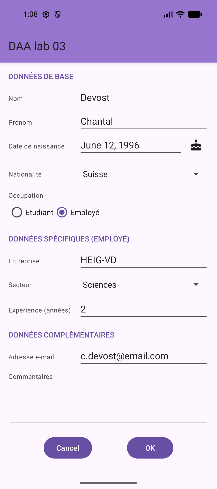
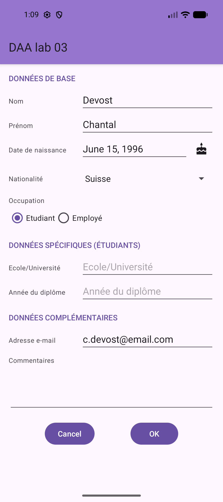
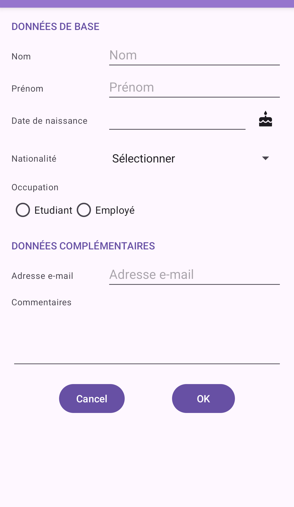
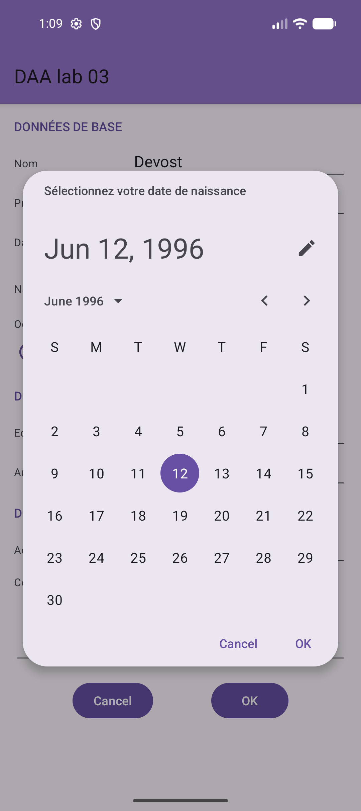
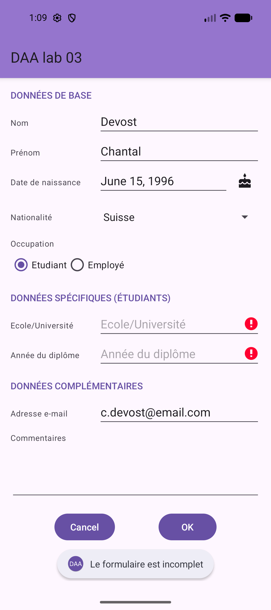

# DAA – Laboratoire 3

## Interactions avec l'utilisateur : approche MVC

| |                                           |
| --- |-------------------------------------------|
| **Auteurs** | François de Courville, Jonatan Perret     |
| **Groupe** | B_2                                       |
| **Classe** | DAA                                       |
| **Date** | 01.11.2026                                |
| **Cours** | DAA – Développement d'Application Android |

## Introduction

Ce laboratoire a pour but de réaliser une activité qui propose un formulaire pour éditer les informations d'une personne, en suivant une approche MVC :

- la **vue** est le layout du formulaire (`activity_main.xml`) ;
- le **modèle** est fourni dans `Person.kt`, avec la classe abstraite `Person` et ses deux sous-classes `Student` et `Worker` ;
- le **contrôleur** est l'activité (`MainActivity`), qui fait le lien entre les deux.

Nous décrivons d'abord notre implémentation et nos choix, puis nous répondons aux questions de la donnée.
Les tests effectués et leurs résultats sont regroupés à la fin du rapport.

## Mise en place

Nous sommes partis du projet template de Cyberlearn, renommé en `daa-labo3` avec le package `ch.heigvd.iict.daa.labo3`.
Les fichiers fournis ont été intégrés au projet :

| Fichier | Emplacement |
| --- | --- |
| `Person.kt` | `app/src/main/java/ch/heigvd/iict/daa/labo3/` (package adapté) |
| `strings.xml` | `app/src/main/res/values/` |
| `cake.xml` | `app/src/main/res/drawable/` |

Les fichiers fournis avaient des fins de ligne Windows (CRLF), nous les avons convertis en LF comme le reste du projet.

## La vue

### Implémentation et choix

Tout le formulaire est mis en page dans un **seul `ConstraintLayout`**.
Celui-ci est placé dans une `ScrollView`, sinon le formulaire ne tient pas à l'écran en paysage ou quand le clavier est ouvert.

Une `Guideline` verticale à 35 % sépare la colonne des labels de celle des champs.
Les labels sont alignés sur la *baseline* de leur `EditText`, ou centrés verticalement sur leur `Spinner`.

Les champs propres aux étudiants et ceux propres aux employés sont regroupés dans deux `Group` :

```xml
<androidx.constraintlayout.widget.Group
    android:id="@+id/group_student"
    android:visibility="gone"
    app:constraint_referenced_ids="title_student,label_school,edit_school,label_graduationyear,edit_graduationyear" />
```

Changer la visibilité du `Group` affiche ou cache d'un coup toutes les vues qu'il référence, sans devoir imbriquer de layout.

La difficulté est de placer la section « Données complémentaires » sous la section spécifique qui est visible.
Nous utilisons une `Barrier` qui référence le `RadioGroup` et le dernier champ de chacune des deux sections :

```xml
<androidx.constraintlayout.widget.Barrier
    android:id="@+id/barrier_specific"
    app:barrierDirection="bottom"
    app:constraint_referenced_ids="radiogroup_occupation,edit_graduationyear,edit_experience" />
```

Une vue `gone` est réduite à un point à sa position, la barrière se trouve donc toujours sous la section visible, ou sous le `RadioGroup` si aucune occupation n'est choisie.

Le seul layout imbriqué est le `RadioGroup`. Il est nécessaire pour que les deux `RadioButton` soient mutuellement exclusifs.

La date de naissance est un `EditText` qui ne peut pas être édité au clavier (`focusable="false"`, `inputType="none"`).
Un clic sur le champ ou sur le bouton avec le gâteau à côté ouvre le `DatePicker`.

Les styles des titres de section et des labels sont regroupés dans `values/styles.xml`.

{ width=22% }
{ width=22% }
{ width=22% }

## Le contrôleur

### Implémentation et choix

Au premier lancement, `fillForm()` remplit le formulaire avec `Person.exampleWorker`.
Cette initialisation se fait seulement si `savedInstanceState` est `null`, sinon elle écraserait ce que l'utilisateur a saisi avant une rotation.
Nous travaillons sur une copie de la date de naissance pour ne pas modifier l'objet d'exemple.

Le `RadioGroup` a un `OnCheckedChangeListener` qui appelle `updateOccupationViews()`.
Cette méthode affiche le `Group` qui correspond à l'occupation choisie et cache l'autre :

```kotlin
val checkedId = radioGroupOccupation.checkedRadioButtonId
groupStudent.visibility = if (checkedId == R.id.radio_student) View.VISIBLE else View.GONE
groupWorker.visibility = if (checkedId == R.id.radio_worker) View.VISIBLE else View.GONE
```

Le bouton **OK** appelle `createPersonFromForm()`, qui vérifie les champs obligatoires : nom, prénom, date de naissance, nationalité, occupation et les champs spécifiques à l'occupation.
Les champs manquants sont signalés avec `setError()`. Si tout est rempli, un `Student` ou un `Worker` est créé et affiché dans les logs avec `Log.i`.
L'e-mail et les commentaires sont facultatifs.

Le bouton **Annuler** appelle `clearForm()`, qui vide tous les champs, remet les spinners sur « Sélectionner », décoche l'occupation et efface les erreurs.
Décocher l'occupation déclenche le listener, les deux sections spécifiques sont donc cachées.

Pour la rotation, le contenu des vues qui ont un `android:id` est sauvegardé automatiquement par le système (texte des `EditText`, sélection des `Spinner`, bouton radio coché).
Seule la date de naissance, qui est une variable de l'activité, est sauvegardée dans `onSaveInstanceState()` et restaurée dans `onRestoreInstanceState()`.

## Questions

> 4.1 Pour le champ remark, destiné à accueillir un texte pouvant être plus long qu'une seule ligne, quelle configuration particulière faut-il faire dans le fichier XML pour que son comportement soit correct ? Nous pensons notamment à la possibilité de faire des retours à la ligne, d'activer le correcteur orthographique et de permettre au champ de prendre la taille nécessaire.

Par défaut, un `EditText` ne contient qu'une seule ligne. Il faut configurer :

- `inputType="textMultiLine"` pour autoriser les retours à la ligne. La touche Entrée insère alors un `\n` au lieu de passer au champ suivant.
- `textAutoCorrect` dans le même `inputType` pour activer le correcteur orthographique, et `textCapSentences` pour avoir une majuscule en début de phrase.
- `layout_height="wrap_content"` sans `maxLines`, pour que le champ grandisse avec son contenu. Avec un `maxLines`, le champ arrête de grandir et le texte défile à l'intérieur.
- `minLines="3"` pour que le champ soit assez grand dès le départ et que l'utilisateur comprenne qu'il peut écrire un long texte.
- `gravity="top|start"` pour que le texte commence en haut à gauche, et pas au milieu du champ.

```xml
<EditText
    android:id="@+id/edit_remark"
    android:layout_width="0dp"
    android:layout_height="wrap_content"
    android:gravity="top|start"
    android:inputType="textMultiLine|textCapSentences|textAutoCorrect"
    android:minLines="3"
    android:scrollHorizontally="false" />
```

> 4.2 Pour afficher la date sélectionnée via le DatePicker nous pouvons utiliser un DateFormat permettant par exemple d'afficher 12 juin 1996 à partir d'une instance de Date. Le formatage des dates peut être relativement différent en fonction des langues, la traduction des mois par exemple, mais également des habitudes régionales différentes : la même date en anglais britannique serait 12th June 1996 et en anglais américain June 12, 1996. Comment peut-on gérer cela au mieux ?

Il ne faut pas écrire le format nous-mêmes (par exemple `"dd MMMM yyyy"`), car l'ordre, la ponctuation et les noms des mois dépendent de la langue et de la région.
Il faut utiliser un formateur localisé, qui choisit le format à partir de la `Locale` du téléphone :

```kotlin
private val dateFormatter = DateFormat.getDateInstance(DateFormat.LONG)

editBirthDate.setText(dateFormatter.format(birthDay.time))
```

Le style (`SHORT`, `MEDIUM`, `LONG`, `FULL`) choisit seulement la quantité d'information à afficher, c'est la locale qui décide de la mise en forme.
Avec `LONG`, on obtient `12 juin 1996` en français, `June 12, 1996` en anglais américain et `12 June 1996` en anglais britannique.
Notre émulateur est configuré en anglais américain et la date s'affiche bien `June 12, 1996`.

Le format `12th June 1996` (avec le suffixe ordinal) n'est pas produit par les formateurs standards, le format britannique de référence est `12 June 1996`.

Il faut aussi faire attention à créer le formateur avec la locale courante.
Un changement de langue est un changement de configuration, l'activité est donc recréée. Notre formateur est un attribut de l'activité, il est recréé avec elle et suit la nouvelle langue.
Au contraire, `Person.dateFormatter` est dans un `companion object` : il garde la locale du moment où il a été créé tant que l'application tourne.

D'autres API existent :

- `DateTimeFormatter.ofLocalizedDate(FormatStyle.LONG)` de `java.time`, plus moderne, mais disponible seulement depuis l'API 26 (notre `minSdk` est 23) ;
- `android.text.format.DateFormat.getBestDateTimePattern(locale, "dMMMMyyyy")`, si on veut choisir précisément les éléments affichés et laisser Android trouver le bon ordre pour la locale.

> 4.3 b. Si vous avez utilisé le MaterialDatePicker de la librairie Material. Est-il possible de limiter les dates sélectionnables dans le dialogue ? Ceci en particulier pour une date de naissance car il est peu probable d'avoir une personne née il y a plus de 110 ans ou à une date dans le futur. Comment pouvons-nous mettre cela en place ?

Nous avons utilisé le `MaterialDatePicker`. Oui, c'est possible avec des `CalendarConstraints` :

- `setStart()` et `setEnd()` limitent les mois qu'on peut afficher, on ne peut pas naviguer plus loin ;
- `setValidator()` limite les jours qu'on peut sélectionner, les autres sont grisés.

`DateValidatorPointForward.from(x)` accepte seulement les dates après `x` et `DateValidatorPointBackward.before(x)` seulement celles avant `x`. `CompositeDateValidator.allOf()` permet de combiner les deux.

```kotlin
val today = MaterialDatePicker.todayInUtcMilliseconds()
val minDate = Calendar.getInstance(TimeZone.getTimeZone("UTC")).apply {
    timeInMillis = today
    add(Calendar.YEAR, -110)
}.timeInMillis

val constraints = CalendarConstraints.Builder()
    .setStart(minDate)
    .setEnd(today)
    .setOpenAt(selection)
    .setValidator(
        CompositeDateValidator.allOf(
            listOf(DateValidatorPointForward.from(minDate), DateValidatorPointBackward.before(today))
        )
    )
    .build()

val picker = MaterialDatePicker.Builder.datePicker()
    .setTitleText(R.string.main_base_birthdate_dialog_title)
    .setSelection(selection)
    .setCalendarConstraints(constraints)
    .build()
```

`selection` vaut la date de naissance si elle est définie, sinon la date du jour.

Le `MaterialDatePicker` travaille avec des timestamps à minuit UTC.
Nous faisons donc les calculs dans un `Calendar` en UTC, et nous convertissons la date choisie en date locale. Sans cette conversion, on peut se retrouver avec un jour de décalage selon le fuseau horaire.

Le `MaterialDatePicker` est un `DialogFragment`, il est donc recréé par le `FragmentManager` après une rotation et il n'y a pas de `WindowLeaked`.
Par contre, ses listeners ne sont pas conservés. Nous les rattachons dans `onCreate()`, sinon la date choisie après une rotation serait perdue :

```kotlin
(supportFragmentManager.findFragmentByTag(DATE_PICKER_TAG) as? MaterialDatePicker<Long>)
    ?.let { attachBirthDatePickerListener(it) }
```

{ width=22% }

> 4.4 Lors du remplissage des champs textuels, vous pouvez constater que le bouton « suivant » présent sur le clavier virtuel permet de sauter automatiquement au prochain champ à saisir. Est-ce possible de spécifier son propre ordre de remplissage du questionnaire ? Arrivé sur le dernier champ, est-il possible de faire en sorte que ce bouton soit lié au bouton de validation du questionnaire ?

Oui pour les deux.

Par défaut, Android choisit le champ suivant selon la position des vues à l'écran.
On peut imposer l'ordre avec `imeOptions="actionNext"`, qui affiche le bouton « suivant », et `nextFocusForward`, qui indique le champ suivant :

```xml
<EditText
    android:id="@+id/edit_name"
    android:imeOptions="actionNext"
    android:nextFocusForward="@id/edit_firstname" />
```

Dans notre formulaire, le champ après le prénom dépend de l'occupation choisie. Nous le changeons donc dans le code, dans `updateOccupationViews()` :

```kotlin
editFirstName.nextFocusForwardId = when (radioGroupOccupation.checkedRadioButtonId) {
    R.id.radio_student -> R.id.edit_school
    R.id.radio_worker -> R.id.edit_company
    else -> R.id.edit_email
}
```

Pour lier le dernier champ au bouton de validation, on met `imeOptions="actionDone"` sur ce champ, puis on récupère l'action avec un `OnEditorActionListener` qui clique sur le bouton OK :

```xml
<EditText
    android:id="@+id/edit_email"
    android:imeOptions="actionDone"
    android:inputType="textEmailAddress" />
```

```kotlin
editEmail.setOnEditorActionListener { _, actionId, _ ->
    if (actionId == EditorInfo.IME_ACTION_DONE) {
        findViewById<Button>(R.id.btn_ok).performClick()
        true
    } else false
}
```

Comme indiqué dans la donnée, cela ne marche pas bien si le dernier champ est `remark`.
Avec `textMultiLine`, la touche Entrée sert à faire un retour à la ligne et la plupart des claviers ignorent `imeOptions`. Il faut alors mettre l'e-mail en dernier.

> 4.5 Pour les deux Spinners (nationalité et secteur d'activité), comment peut-on faire en sorte que le premier choix corresponde au choix null, affichant par exemple le label « Sélectionner » ? Comment peut-on gérer cette valeur pour ne pas qu'elle soit confondue avec une réponse ?

Un `Spinner` a toujours un élément sélectionné, il n'a pas d'état « rien de sélectionné ».
Nous ajoutons donc un élément « Sélectionner » en première position de l'adapter, et la position 0 correspond à `null` :

```kotlin
private fun createSpinnerAdapter(@ArrayRes values: Int, @StringRes emptyLabel: Int): ArrayAdapter<String> {
    val items = listOf(getString(emptyLabel)) + resources.getStringArray(values)
    return object : ArrayAdapter<String>(this, android.R.layout.simple_spinner_item, items) {
        override fun isEnabled(position: Int) = position != NO_SELECTION

        override fun getDropDownView(position: Int, convertView: View?, parent: ViewGroup): View =
            super.getDropDownView(position, convertView, parent).apply {
                alpha = if (position == NO_SELECTION) 0.5f else 1f
            }
    }.apply { setDropDownViewResource(android.R.layout.simple_spinner_dropdown_item) }
}
```

Dans la liste déroulante, « Sélectionner » est grisé et ne peut pas être choisi (`isEnabled()` retourne `false`).

Pour ne pas confondre cette valeur avec une réponse, nous ne lisons jamais directement le texte sélectionné. Nous passons par une méthode qui retourne `null` pour la position 0 :

```kotlin
private fun getSpinnerValue(spinner: Spinner): String? =
    if (spinner.selectedItemPosition == NO_SELECTION) null
    else spinner.selectedItem as String
```

On teste la position et pas le texte, il n'y a donc pas de confusion possible, même si l'application est traduite.
Lors de la validation, une valeur `null` est traitée comme un champ obligatoire manquant.
Dans l'autre sens, pour afficher une valeur du modèle, on cherche sa position dans l'adapter. Si elle est `null` ou inconnue, on sélectionne la position 0.

## Tests effectués et résultats

Les tests ont été effectués le 28.10.2026 sur un émulateur Pixel 10a (Android API 37), configuré en anglais américain.
Tous les résultats obtenus correspondent aux résultats attendus.

| Manipulation | Résultat obtenu |
| --- | --- |
| Lancer l'application | Le formulaire est rempli avec `exampleWorker`, seule la section « employé » est affichée. |
| Appuyer sur OK | Le `Worker` est affiché dans les logs et un message « Employé créé » s'affiche. |
| Cocher « Etudiant » | La section « employé » est cachée, la section « étudiant » s'affiche et les données complémentaires remontent sous celle-ci. |
| Ouvrir le `DatePicker` avec le bouton gâteau | Le calendrier s'ouvre sur le 12 juin 1996, la date de naissance actuelle. |
| Tourner l'écran deux fois avec le `DatePicker` ouvert, puis choisir le 15 | Pas d'erreur dans les logs, la date devient `June 15, 1996` et l'occupation « Etudiant » est conservée. |
| Appuyer sur OK avec l'école et l'année du diplôme vides | Les deux champs sont marqués en erreur et le message « Le formulaire est incomplet » s'affiche. |
| Appuyer sur Annuler | Tous les champs sont vides, les spinners affichent « Sélectionner » et aucune section spécifique n'est affichée. |

Log obtenu en appuyant sur OK au lancement :

```
I MainActivity: Worker - name: Devost, firstName: Chantal, birthDay: Jun 12, 1996, nationality: Suisse, email: c.devost@email.com, remark: , company: HEIG-VD, sector: Sciences, experienceYear: 2
```

{ width=22% }

## Utilisation d'outils d'IA

Nous avons utilisé Claude Code (Anthropic) pendant ce laboratoire. Voici ce qui vient de l'outil et ce qui vient de nous.

- **Manipulations** : l'IA a été utilisée pour renommer le projet (package name), ainsi qu'en tant que correcteur d'orthographe pour ce rapport.
- **Tests** : l'IA a exécuté les manipulations et les tests sur l'émulateur et a mis en forme les résultats.
- **Rapport et commentaires** : l'IA a mis en forme le rapport ainsi que les diagrammes, rédigé les descriptions d'implémentation à partir du code et ajouté les commentaires de documentation dans les fichiers Kotlin.

Nous avons relu le code et les textes produits par l'IA avant le rendu.

## Conclusion

Ce laboratoire nous a permis de construire un formulaire complet avec un seul `ConstraintLayout`, grâce aux `Guideline`, `Group` et `Barrier`.
Nous avons vu que le contrôleur fait bien le lien entre la vue et le modèle : il remplit les vues à partir d'un objet, et crée un objet à partir des vues.
Le point qui nous a demandé le plus d'attention est la date de naissance : le `MaterialDatePicker` travaille en UTC, et ses listeners doivent être rattachés après une rotation.

## Bibliographie

- Donnée du laboratoire 3 et supports du cours DAA, HEIG-VD.
- Documentation Android, *Build a responsive UI with ConstraintLayout* : <https://developer.android.com/develop/ui/views/layout/constraint-layout>
- Documentation Android, *Spinners* : <https://developer.android.com/develop/ui/views/components/spinner>
- Documentation Android, *Specify the input method type* : <https://developer.android.com/develop/ui/views/touch-and-input/keyboard-input/style>
- Material Components, *Date pickers* : <https://github.com/material-components/material-components-android/blob/master/docs/components/DatePicker.md>
